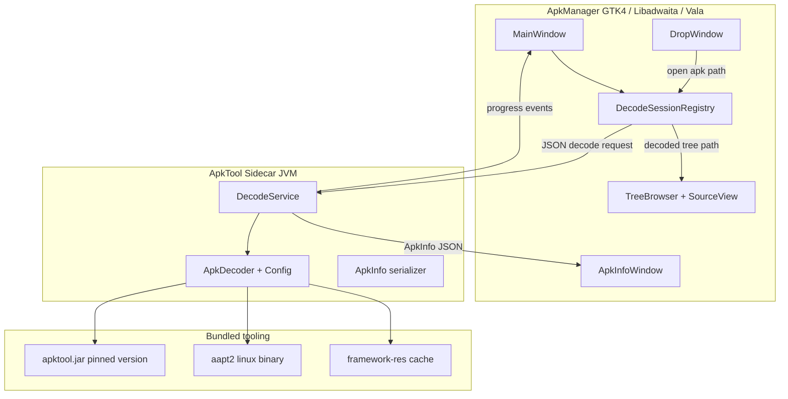

# Methodology: Converting Apktool into a GTK desktop GUI (ApkManager) for reading APK contents on Debian and Fedora

**Date:** October 6, 2026 (`date +%Y%m%d` → `20261006`)  
**Author:** Grok 4.7  
**Category:** Desktop / GTK / Libadwaita / Apktool / Android reverse-engineering / Linux packaging  
**Status:** Plan — architecture and phased implementation for a new **ApkManager** application  
**Scope:** Read-only APK inspection on **Debian/Ubuntu** and **Fedora/RHEL-family** workstations (build, install, and daily use)

**Related references (workspace):**
- Apktool source: `Others/Apktool/` — CLI wrapper (`scripts/linux/apktool`), `ApkDecoder`, `ApkBuilder`, `Config`
- UX / stack reference: `Others/AppManager/` — GTK 4 + Libadwaita + Vala + Meson; drag-and-drop window, info window, registry, MIME handlers
- Methodology schema reference: `Applications/Sparkplate.fresh/docs/methodologies/` (header blocks, phased plans, distro package tables, document history)

**Primary targets (to be created):**
- `Applications/ApkManager/` — new project root
- `Applications/ApkManager/meson.build` — build system (mirror AppManager layout)
- `Applications/ApkManager/scripts/fetch-apktool.sh` — pin and bundle `apktool.jar` + platform `aapt2`/`aapt` binaries
- `Applications/ApkManager/data/com.github.ApkManager.metainfo.xml` — Flathub / software center metadata

---

## 1. Goal and scope

**Apktool** is a mature Java CLI that decodes Android APK files into human-readable artifacts: `AndroidManifest.xml`, `res/`, `smali/`, `assets/`, `lib/`, and `apktool.yml`. It is the standard open-source tool for inspecting and reverse-engineering APK structure on Linux, but it has **no first-party GUI**.

**AppManager** (`Others/AppManager/`) is a GTK/Libadwaita desktop utility for **AppImages** (not Android APKs). Its value for this project is **interaction design and engineering patterns**, not domain logic:

| AppManager pattern | ApkManager equivalent |
|--------------------|----------------------|
| Double-click `.AppImage` → drag-and-drop install window | Double-click `.apk` → open / decode prompt window |
| Main window listing installed apps | Main window listing recently opened / decoded APKs |
| `AppImageInfoWindow` — grouped metadata (General, Filesystem, Integrity) | `ApkInfoWindow` — grouped metadata (Package, SDK, Signing, Components) |
| `InstallationRegistry` + GSettings | `DecodeSessionRegistry` + cache directory preferences |
| Background worker for updates | Background worker for `apktool d` decode jobs |
| MIME handler + `.desktop` file | Register `application/vnd.android.package-archive` handler |
| CLI: `app-manager install …` | CLI: `apk-manager open …`, `apk-manager decode …` |

### 1.1 In scope

- Open an APK from file picker, drag-and-drop, or double-click (MIME association).
- Decode APK contents with Apktool into a managed cache directory.
- Browse decoded tree: manifest, resources, smali, assets, native libs, unknown files.
- View formatted manifest and key `apktool.yml` / `ApkInfo` fields without leaving the app.
- Export individual files or the full decoded tree.
- Debian and Fedora **native** build and runtime (no Docker required for daily use).

### 1.2 Out of scope (initial releases)

- Rebuilding / resigning APKs (`apktool b`) — can be Phase 2+ behind an explicit “Advanced” mode.
- Live debugging on a connected device (use `adb` separately).
- Full Java decompiler UI (optional JADX integration as a later plugin).
- Windows/macOS packaging (Linux-first; patterns from Sparkplate Electron docs apply if cross-platform is needed later).

---

## 2. Why a GUI wrapper instead of modifying Apktool core

Apktool’s architecture already separates concerns cleanly:

```
brut.apktool/apktool-cli/     → Main.java (Apache Commons CLI)
brut.apktool/apktool-lib/     → ApkDecoder, ApkBuilder, Config, ResDecoder, SmaliDecoder
scripts/linux/apktool           → java -jar apktool.jar "$@"
```

The CLI `Main` class constructs a `Config`, instantiates `ApkDecoder`, and calls `decode(outDir)`. The library exposes rich metadata via `ApkInfo` (SDK levels, version codes, framework usage, feature flags) after decode.

**Do not fork Apktool into a monolithic Swing app.** Instead, build **ApkManager** as a thin, distro-friendly shell that:

1. Invokes Apktool (subprocess or embedded JVM — see §3).
2. Presents decoded output in a native GTK file tree and text views.
3. Manages cache, preferences, and desktop integration the way AppManager does for AppImages.

This keeps Apktool upgrades independent (swap the bundled JAR) and avoids maintaining duplicate decode logic.

---

## 3. Architecture options

### 3.1 Decision matrix

| Approach | Stack | Pros | Cons | Fit for AppManager-like UX |
|----------|-------|------|------|------------------------------|
| **A — GTK shell + Apktool subprocess** | Vala, Libadwaita, Meson | Matches AppManager exactly; simplest; clear process boundary; easy logging | Parse stdout/stderr for progress; JVM startup per decode | **Best MVP** |
| **B — GTK shell + long-lived Java sidecar** | Vala + small Java HTTP/Unix-socket service using `apktool-lib` | Progress callbacks, reuse JVM, direct `ApkInfo` JSON | More moving parts; must ship JRE | **Best v1.0** |
| **C — Electron + bundled JRE** | Electron, Vue/React, `child_process` | Rich web UI for smali/XML; familiar if team uses Sparkplate patterns | Heavy runtime (~150 MB+); not native GNOME look | Good if web team owns UI |
| **D — Extend Apktool repo with JavaFX** | Java only | Single artifact | Diverges from upstream; poor GNOME integration | Poor match for “like AppManager” |

**Recommendation:** Start with **A**, evolve to **B** once decode progress and metadata APIs stabilize.

### 3.2 Recommended system diagram (Phase B target)



### 3.3 Subprocess contract (Phase A — MVP)

Mirror AppManager’s pattern of shelling out to bundled tools (`unsquashfs`, `dwarfsextract`):

```bash
# Bundled next to the installed binary (see AppManager scripts/fetch-*)
APKMANAGER_APKTOOL="$PREFIX/lib/apk-manager/apktool/apktool.jar"
APKMANAGER_AAPT2="$PREFIX/lib/apk-manager/apktool/linux/aapt2"

export PATH="$PREFIX/lib/apk-manager/apktool/linux:$PATH"

java -Xmx1024M -Dfile.encoding=utf-8 \
  -Djdk.util.zip.disableZip64ExtraFieldValidation=true \
  -Djdk.nio.zipfs.allowDotZipEntry=true \
  -jar "$APKMANAGER_APKTOOL" d \
  -f -o "$CACHE_DIR/$SESSION_ID" \
  --frame-path "$FRAMEWORK_DIR" \
  "$APK_PATH"
```

Flags exposed in the GUI (map 1:1 to Apktool CLI options from `Main.java`):

| GUI preference | Apktool flag | Default for read-only browsing |
|----------------|--------------|--------------------------------|
| Decode smali sources | _(default on)_ | On |
| Skip smali (`--no-src`) | `-s` / `--no-src` | Off |
| Skip resources | `-r` / `--no-res` | Off |
| Manifest only | `--only-manifest` | Off |
| Decode all dex | `-a` / `--all-src` | Off (enable for multi-dex edge cases) |
| Force overwrite cache | `-f` / `--force` | On (managed cache dirs) |
| Parallel jobs | `-j N` / `--jobs N` | `min(4, nproc)` |
| Framework path | `-p` / `--frame-path` | `$XDG_CACHE_HOME/apk-manager/frameworks` |

---

## 4. UX specification (AppManager parity)

Study these AppManager sources when implementing ApkManager windows:

| AppManager file | ApkManager analogue |
|-----------------|---------------------|
| `src/windows/drop_window.vala` | `src/windows/drop_window.vala` — `.apk` drop target, “Open & decode” CTA |
| `src/windows/app_image_info_window.vala` | `src/windows/apk_info_window.vala` — package name, version, SDK, permissions summary |
| `src/windows/main_window.vala` | `src/windows/main_window.vala` — session list, search, open file |
| `src/windows/details_window.vala` | `src/windows/decode_options_window.vala` — advanced decode flags |
| `src/core/installation_registry.vala` | `src/core/decode_session_registry.vala` — JSON index under `~/.local/share/apk-manager/sessions.json` |
| `src/core/background_update_service.vala` | `src/core/decode_worker.vala` — `Gio.Subprocess` or sidecar client |
| `src/application.vala` | MIME open handler for `*.apk` |

### 4.1 Primary user flows

1. **Quick inspect:** User double-clicks `myapp.apk` → DropWindow shows app icon (extracted from APK via `aapt2` or decoded `res/mipmap`) → “Decode & Browse” → MainWindow tree view.
2. **Manifest-first:** User enables “Manifest only” in preferences → fast decode → XML pretty-print in `GtkSourceView` with syntax highlighting.
3. **Deep browse:** Full decode → tree panes for `smali/`, `res/`, `assets/`, `lib/` → double-click file opens appropriate viewer (text, hex for binaries, image preview for PNG/WebP).
4. **Export:** Context menu “Export file…” / “Export decoded folder as ZIP…” using `Gtk.FileDialog` (same pattern as AppManager’s file utilities).

### 4.2 Viewers (read-only)

| Content type | Viewer |
|--------------|--------|
| `AndroidManifest.xml` | GtkSourceView, XML language |
| `apktool.yml` | GtkSourceView, YAML |
| `smali/**/*.smali` | GtkSourceView, custom smali lang spec (optional) |
| `res/values/*.xml` | GtkSourceView, XML |
| PNG / WebP drawables | `Gtk.Picture` |
| `.so` native libs | Hex dump (first N KiB) + “open in external tool” |
| DEX inside APK (without full decode) | Optional: list via `aapt2 dump badging` subprocess |

---

## 5. Apktool integration details

### 5.1 Runtime requirements

From `Others/Apktool/build.gradle.kts`:

- **JDK 17+** to run the shipped `apktool.jar` (Gradle build of Apktool itself also requires JDK 17).
- **aapt2** (and legacy **aapt** where needed) — Apktool ships platform-specific binaries; the Linux wrapper adds the script directory to `PATH` (see `scripts/linux/apktool` lines 79–81).

ApkManager should **bundle** a pinned Apktool release (JAR + `aapt2`) under `$prefix/lib/apk-manager/apktool/`, the same way AppManager bundles `unsquashfs` / DwarFS tools. Do not rely on distro `apktool` packages (often stale).

### 5.2 Framework files

Some APKs require framework resources (`1.apk`, etc.). Apktool installs these via `apktool if framework-res.apk`. ApkManager must:

- Store frameworks in `$XDG_CACHE_HOME/apk-manager/frameworks/` (or configurable).
- Pass `--frame-path` on every decode.
- Surface `FrameworkNotFoundException` in the UI with a guided “Install framework…” file picker.

### 5.3 Metadata without full decode (fast path)

For the info window before decode completes, shell out:

```bash
aapt2 dump badging "$APK" 2>/dev/null || aapt dump badging "$APK"
```

Parse `package:`, `sdkVersion:`, `targetSdkVersion:`, `application-label:`, `launchable-activity:`, `uses-permission:` lines into `ApkMetadata` (Vala class mirroring `AppImageMetadata`).

After decode, merge in fields from `$OUT/apktool.yml` via a small YAML parser (`json-glib` cannot parse YAML — use `libyaml` Vala binding or invoke `python3 -c` as a temporary MVP).

### 5.4 Sidecar API sketch (Phase B)

Long-lived Java process started by `Application`:

```
POST /decode   { apkPath, outDir, options } → { sessionId }
GET  /progress/{sessionId}                  → { phase, percent, logLine }
GET  /apkinfo/{sessionId}                   → ApkInfo JSON
DELETE /session/{sessionId}                 → cleanup
```

Implement with Javalin or plain `com.sun.net.httpserver` on `127.0.0.1:0`, port written to `$XDG_RUNTIME_DIR/apk-manager-sidecar.port`.

---

## 6. Project layout (proposed)

```
Applications/ApkManager/
├── meson.build
├── meson_options.txt
├── README.md
├── docs/
│   └── 20261006.methodology.apktool.gui.apkmanager.debian.fedora.md
├── scripts/
│   ├── fetch-apktool.sh          # Download pinned apktool.jar + aapt2
│   └── make-appimage.sh            # Optional; mirror AppManager release flow
├── data/
│   ├── com.github.ApkManager.desktop.in
│   ├── com.github.ApkManager.metainfo.xml
│   ├── com.github.ApkManager.gschema.xml
│   └── mime/com.github.ApkManager.apk.xml
├── sidecar/                        # Phase B
│   ├── build.gradle.kts
│   └── src/main/java/.../DecodeServer.java
└── src/
    ├── main.vala
    ├── application.vala
    ├── core/
    │   ├── apk_metadata.vala
    │   ├── decode_session.vala
    │   ├── decode_session_registry.vala
    │   ├── decode_worker.vala
    │   ├── apktool_runner.vala
    │   └── app_paths.vala
    ├── windows/
    │   ├── main_window.vala
    │   ├── drop_window.vala
    │   ├── apk_info_window.vala
    │   └── content_browser_window.vala
    └── utils/
        ├── file_utils.vala
        └── ui_utils.vala
```

---

## 7. Debian and Fedora host preparation

### 7.1 Decision matrix — tooling per distro

| Need | Debian / Ubuntu | Fedora / RHEL-family | Notes |
|------|-----------------|----------------------|-------|
| **JRE to run Apktool** | `openjdk-17-jre-headless` | `java-17-openjdk-headless` | Must be ≥ 17 per Apktool 3.x |
| **JDK (build sidecar only)** | `openjdk-17-jdk-headless` | `java-17-openjdk-devel` | Phase B only |
| **GTK / Libadwaita dev** | `libadwaita-1-dev`, `libgtk-4-dev` | `libadwaita-devel`, `gtk4-devel` | Match AppManager ≥ libadwaita 1.6 |
| **Vala / Meson** | `valac`, `meson`, `ninja-build` | `vala`, `meson`, `ninja-build` | Same as AppManager |
| **JSON / Soup** | `libjson-glib-dev`, `libsoup-3.0-dev` | `json-glib-devel`, `libsoup3-devel` | Session index, future sidecar HTTP |
| **Source editing** | `libgtksourceview-5-dev` | `gtksourceview5-devel` | Manifest / smali views |
| **YAML (optional)** | `libyaml-dev` | `libyaml-devel` | Parse `apktool.yml` natively |
| **Desktop integration** | `desktop-file-utils` | `desktop-file-utils` | MIME cache updates |
| **Inspection tools** | `aapt` *(not in all repos)* — prefer bundled aapt2 | same | Bundle via `fetch-apktool.sh` |

### 7.2 Debian / Ubuntu — one-shot dev install

```bash
sudo apt update
sudo apt install -y \
  valac meson ninja-build pkg-config \
  libadwaita-1-dev libgtk-4-dev libgtksourceview-5-dev \
  libglib2.0-dev libjson-glib-dev libgee-0.8-dev \
  libsoup-3.0-dev libgirepository1.0-dev \
  openjdk-17-jre-headless openjdk-17-jdk-headless \
  desktop-file-utils git curl unzip
```

### 7.3 Fedora — one-shot dev install

```bash
sudo dnf install -y \
  vala meson ninja-build \
  libadwaita-devel gtk4-devel gtksourceview5-devel \
  glib2-devel json-glib-devel libgee-devel libsoup3-devel \
  java-17-openjdk-headless java-17-openjdk-devel \
  desktop-file-utils git curl unzip
```

### 7.4 Build and install (same pattern as AppManager)

```bash
cd Applications/ApkManager
./scripts/fetch-apktool.sh          # vendor apktool.jar + aapt2 into subprojects/
meson setup build --prefix=$HOME/.local
meson compile -C build
meson install -C build
update-desktop-database ~/.local/share/applications   # register MIME handler
```

---

## 8. Phased implementation plan

### Phase 0 — Scaffold (1–2 days)

- [ ] Create Meson project mirroring `Others/AppManager/meson.build` dependencies.
- [ ] Add `fetch-apktool.sh` pinning a known-good Apktool release from `Others/Apktool` or upstream Bitbucket/GitHub downloads.
- [ ] Verify bundled `java -jar apktool.jar d` works on Debian and Fedora test hosts.
- [ ] Empty `MainWindow` + `DropWindow` accepting `.apk` paths.

### Phase 1 — MVP subprocess decode (1 week)

- [ ] `ApktoolRunner` — `Gio.Subprocess` wrapper with stdout/stderr capture and cancel (`send_signal`).
- [ ] Cache layout: `~/.cache/apk-manager/decoded/<sha256>/`.
- [ ] `DecodeSessionRegistry` — track APK path, cache dir, timestamp, decode options.
- [ ] `Gtk.TreeView` or `Adw.NavigationView` file browser over decoded directory.
- [ ] Text viewer for manifest and smali/xml files.
- [ ] `.desktop` + MIME XML for `application/vnd.android.package-archive`.

### Phase 2 — Info window and fast metadata (3–5 days)

- [ ] `ApkMetadata` from `aapt2 dump badging` before decode.
- [ ] `ApkInfoWindow` — Libadwaita `Adw.PreferencesGroup` sections (Package, SDK, Permissions, Signing).
- [ ] Merge post-decode data from `apktool.yml`.
- [ ] App icon from APK (`aapt2 dump --file resources.arsc` or first decoded mipmap).

### Phase 3 — Sidecar + progress (1–2 weeks)

- [ ] Java sidecar using `apktool-lib` directly (depends on locally built or published JAR).
- [ ] Structured progress (sources / resources / copy unknown files) via `ApkDecoder` phases.
- [ ] Decode queue in main window (parallel jobs capped by `-j` and CPU count).

### Phase 4 — Packaging (3–5 days)

- [ ] AppImage recipe (optional; follow `Others/AppManager/scripts/make-appimage.sh`).
- [ ] `.deb` / `.rpm` spec files bundling JRE headless or declaring `java-17-openjdk-headless` dependency.
- [ ] Flathab manifest with `org.freedesktop.Sdk.Extension.openjdk17` for sandboxed JRE.

### Phase 5 — Advanced (optional)

- [ ] Read-only JADX integration (“View as Java” for selected smali class).
- [ ] Diff two decoded APK sessions.
- [ ] `apktool b` rebuild behind Advanced toggle with strong warning banner.

---

## 9. Packaging strategy on Debian and Fedora

| Format | JRE handling | Apktool binaries | Best for |
|--------|--------------|------------------|----------|
| **Native `.deb` / `.rpm`** | Depends on `openjdk-17-jre-headless` | Bundled under `/usr/lib/apk-manager/apktool/` | Distro package maintainers |
| **AppImage** | Bundle Temurin JRE 17 minimal | Fully bundled | Universal Linux, mirrors AppManager distribution |
| **Flatpak** | `org.freedesktop.Sdk.Extension.openjdk17` | Bundled in app files | Sandboxed GNOME Software installs |

**License compliance:** Apktool is Apache 2.0; aapt/aapt2 are Apache 2.0 (Android SDK build-tools). Document bundled versions in `metainfo.xml` `<bundle type="legal">` entries (same pattern as AppManager’s unsquashfs/DwarFS bundles).

---

## 10. Risks and mitigations

| Risk | Mitigation |
|------|------------|
| Large APK decode blocks UI | Always decode off UI thread; show `Adw.ProgressBar` + cancel |
| Framework missing for system APKs | Framework manager UI + docs link to Apktool wiki |
| Distro Java too old | Require 17+ at startup with clear error dialog |
| aapt2 binary mismatch | Pin Apktool + aapt2 versions together in `fetch-apktool.sh` |
| Legal / ethical misuse | Read-only defaults; splash text: “For legitimate analysis and education only” |
| Cache disk usage | GSettings: max cache size, “Clear all decoded sessions” action |

---

## 11. Acceptance checklist

1. [ ] `meson compile` succeeds on Debian 12+ and Fedora 40+.
2. [ ] Double-clicking an APK opens ApkManager (MIME handler registered).
3. [ ] Decode produces browsable tree matching Apktool CLI output for a test APK.
4. [ ] Manifest and `apktool.yml` render in-app without external editor.
5. [ ] Framework-not-found error is actionable in the GUI.
6. [ ] `apk-manager --version` and `apk-manager open /path/to/app.apk` CLI works.
7. [ ] Uninstall / `meson install` does not leave orphaned JVM processes.

---

## 12. References

- **Internal:** `Others/Apktool/`, `Others/AppManager/`, `Applications/Sparkplate.fresh/docs/methodologies/`
- [Apktool documentation](https://apktool.org/docs/the-basics/intro)
- [Apktool — How to Build](https://apktool.org/docs/build)
- [AppManager (UX reference)](https://github.com/kem-a/AppManager)
- [GTK 4 / Libadwaita Human Interface Guidelines](https://developer.gnome.org/hig/)
- [Android MIME type — APK](https://www.iana.org/assignments/media-types/application/vnd.android.package-archive)
- [Flatpak OpenJDK extension](https://github.com/flathub/org.freedesktop.Sdk.Extension.openjdk17)

---

## 13. Document history

| Date | Author | Change |
|------|--------|--------|
| 2026-10-06 | Grok 4.7 | Initial methodology: Apktool → ApkManager GUI plan for Debian/Fedora, using AppManager UX patterns and Sparkplate methodology schema |
