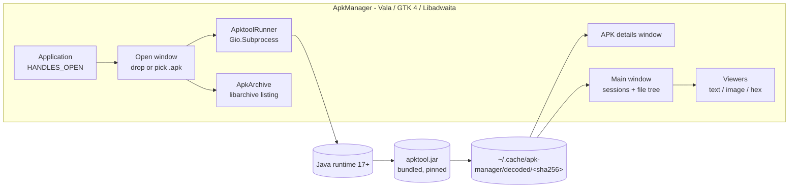

# Methodology: Audited plan — turning Apktool into an AppManager-style GUI for reading APK contents on Debian and Fedora

**Date:** October 6, 2026 (`date +%Y%m%d` → `20261006`)  
**Author:** Claude Opus 5.5 (Anthropic), via Cursor  
**Category:** Desktop / GTK 4 / Libadwaita / Vala / Apktool / Debian / Fedora  
**Status:** Plan — source-checked against `Others/Apktool` and `Others/AppManager`; corrects and narrows the two earlier ApkManager methodologies  
**App:** ApkManager (new, not yet scaffolded)

**Originating prompt (verbatim):**

> How would it be possible to convert @Apktool into a gui application like @AppManager to read the contents of an Android apk on debian and fedora. Please use  @Applications/ApkManager/docs  as a file schema reference and general reference and create a new document in @Applications/ApkManager/docs . Please include your name in the document please and this prompt as well.

**Read alongside (same folder):**

1. [20261006.methodology.apktool.gui.apkmanager.debian.fedora.md](./20261006.methodology.apktool.gui.apkmanager.debian.fedora.md) — architecture options, window mapping, sidecar sketch
2. [20261006.methodology.apkmanager.execution.plan.debian.fedora.gtk.libadwaita.md](./20261006.methodology.apkmanager.execution.plan.debian.fedora.gtk.libadwaita.md) — step-by-step build order

This document keeps their overall direction (a native GTK shell that drives Apktool) and changes the parts that the source code contradicts. Where this document and the earlier two disagree, follow this one.

**Source files checked:**
- `Others/Apktool/brut.apktool/apktool-cli/src/main/java/brut/apktool/Main.java` — commands and flags
- `Others/Apktool/brut.apktool/apktool-lib/src/main/java/brut/androlib/ApkDecoder.java` — decode phases and log lines
- `Others/Apktool/brut.apktool/apktool-lib/src/main/java/brut/androlib/Config.java` — decode options as enums
- `Others/Apktool/brut.apktool/apktool-lib/src/main/java/brut/androlib/res/AaptManager.java` — where `aapt2` comes from
- `Others/Apktool/brut.j.common/src/main/java/brut/common/Log.java` — logging backend
- `Others/Apktool/scripts/linux/apktool` — JVM flags used by the official wrapper
- `Others/AppManager/src/application.vala`, `src/windows/*.vala`, `data/app-manager.desktop.in`, `meson.build`

---

## 1. Short answer

You do not convert Apktool's code into a GUI. Apktool is already split into a library (`apktool-lib`) and a thin command-line front end (`apktool-cli`). You write a second front end.

The recommended front end is a GTK 4 / Libadwaita application written in Vala and built with Meson, because that is exactly how AppManager is built, and AppManager already solves the desktop problems ApkManager has: opening a file from the file manager, showing a details window, running slow work off the UI thread, and installing cleanly on Debian and Fedora.

AppManager manages AppImages, not APKs. Nothing in it reads Android files. It is the template for the shell; Apktool is the engine.

---

## 2. Corrections to the earlier ApkManager documents

These are the findings that change the plan. Each one is backed by a file listed above.

### 2.1 Reading an APK does not need `aapt2`

`AaptManager` is referenced only from `ApkBuilder` and `AaptInvoker` (the build path). `ApkDecoder` decodes `resources.arsc`, the binary `AndroidManifest.xml`, and `classes*.dex` (via baksmali) entirely in Java.

**Consequence:** for a read-only viewer, the only runtime dependency is a Java runtime plus `apktool.jar`. The earlier plans to vendor `aapt2` separately, put it on `PATH`, and treat "aapt2 not found" as a common failure can be dropped for the read-only product.

### 2.2 Apktool already carries its own `aapt2`

`AaptManager.getBinaryFile()` loads `aapt2` from a resource inside the JAR at `/prebuilt/linux/aapt2` (64-bit only) and extracts it to a temp file at runtime. A release `apktool.jar` is therefore self-contained even for `apktool b`.

**Consequence:** if ApkManager later wants `aapt2 dump badging` for a fast metadata preview, it can extract the binary from the same JAR (`unzip -p apktool.jar prebuilt/linux/aapt2`) instead of downloading Android build-tools. Note that this workspace checkout of `Others/Apktool` has no `prebuilt/` directory; those binaries are added during Apktool's release build, so use a release JAR, not a bare source tree.

### 2.3 A fast "manifest only" preview is built in

`Config` exposes `DecodeResources.ONLY_MANIFEST` and `DecodeSources.NONE`, surfaced on the CLI as `--only-manifest` and `-s`. Running both gives a decoded, human-readable `AndroidManifest.xml` and `apktool.yml` in about a second for most APKs, with no `aapt2` involved.

**Consequence:** the info window's first pass should be `apktool d --only-manifest -s`, not `aapt2 dump badging`. One tool, one parser, one failure mode.

### 2.4 Progress can come from Apktool's own log lines

`brut.common.Log` writes through `java.util.logging`, and `ApkDecoder` logs each phase with a stable message:

| Log line (from `ApkDecoder.java`) | Phase shown in the GUI |
|-----------------------------------|------------------------|
| `Using Apktool <ver> on <file>` | Starting |
| `Baksmaling classes.dex...` (one per dex) | Decoding code |
| `Copying raw resources.arsc...` / resource decode | Decoding resources |
| `Copying raw AndroidManifest.xml...` | Manifest |
| `Copying assets...` / `Copying lib...` | Copying raw folders |
| `Copying original files...` | Signatures and originals |
| `Copying unknown files...` | Finishing |

**Consequence:** the subprocess approach can show a real phase indicator by reading stdout line by line. A Java sidecar can do the same by attaching a `java.util.logging.Handler`, without patching Apktool.

### 2.5 The APK MIME type already exists

`application/vnd.android.package-archive` is defined by freedesktop `shared-mime-info`, which Debian and Fedora both install by default. ApkManager only needs `MimeType=application/vnd.android.package-archive;` in its `.desktop` file, the same way `data/app-manager.desktop.in` lists the AppImage types. A custom `mime/*.xml` file is unnecessary.

### 2.6 Java 17 package names are not stable across releases

Apktool needs Java 17 or newer, not Java 17 exactly. Newer Debian and Fedora releases have been moving their default JDK forward, so hard-coding `openjdk-17-*` / `java-17-openjdk-*` will eventually break the install instructions. Depend on the distribution's default headless runtime and check the version at startup (see §5).

---

## 3. Architecture



Two read paths, used together:

| Path | What it shows | Speed | Tool |
|------|---------------|-------|------|
| **Raw listing** | Every entry inside the APK zip: `classes.dex`, `resources.arsc`, `lib/arm64-v8a/*.so`, `assets/*`, `META-INF/*`, with sizes and compression | Instant | `libarchive` from Vala (no Java) |
| **Decoded tree** | Readable `AndroidManifest.xml`, `res/values/*.xml`, `smali/**`, `apktool.yml` | Seconds to minutes | `apktool d` |

The raw listing is the piece the earlier documents missed. It makes the window useful the moment an APK is dropped, before any Java process starts, and it lets the user open plain files (images in `assets/`, native libraries) without a full decode.

### 3.1 Why subprocess first, sidecar later

| | Subprocess (`java -jar apktool.jar d …`) | Long-lived Java sidecar using `apktool-lib` |
|---|---|---|
| Code needed in Java | None | Small server plus a log handler |
| Progress | Parse log lines (§2.4) | Log handler pushes events |
| JVM start cost | Once per decode (roughly 0.5–1 s) | Once per app session |
| Upgrading Apktool | Replace the JAR | Rebuild the sidecar against the new library |
| Failure isolation | A crash kills one decode | A crash kills all decodes in flight |

The subprocess model is what AppManager does with `unsquashfs` and `dwarfsextract`, and it is good enough for a viewer. Move to a sidecar only if users routinely decode many APKs in a row and the start-up cost becomes visible.

---

## 4. Mapping AppManager to ApkManager

These AppManager behaviours were confirmed in source and carry over directly.

| AppManager (confirmed in source) | ApkManager equivalent |
|----------------------------------|-----------------------|
| `Application` created with `HANDLES_OPEN \| HANDLES_COMMAND_LINE`; `open(GLib.File[] files, …)` override (`src/application.vala`) | Same flags; `open` receives `.apk` files from the file manager and routes each to the open window |
| `Exec=@bindir@/app-manager %u` and `MimeType=` list (`data/app-manager.desktop.in`) | `Exec=@bindir@/apk-manager %f`, `MimeType=application/vnd.android.package-archive;` |
| Slow work in `new Thread<void>("appmgr-install", …)` and `ThreadPool` (`drop_window.vala`, `updater.vala`) | Decode in a worker thread or `Gio.Subprocess` async wait; UI updates via `Idle.add` |
| `AppImageInfoWindow` built from `Adw.PreferencesGroup` sections | `ApkInfoWindow` with sections: General, SDK, Permissions, Components, Signing, Files |
| `InstallationRegistry` | `DecodeSessionRegistry` keyed by APK SHA-256 |
| Bundled helper tools fetched by `scripts/fetch-*.sh` | `scripts/fetch-apktool.sh` downloads one pinned `apktool_<ver>.jar` and checks its SHA-256 |
| Meson dependency block (`meson.build`) | Same block plus `gtksourceview-5` and `libarchive` |

### 4.1 What the details window shows, and where each field comes from

All of these come from the `--only-manifest -s` decode in §2.3.

| Section | Field | Source in decoded output |
|---------|-------|--------------------------|
| General | Package name, version name, version code | `AndroidManifest.xml` `<manifest package versionName versionCode>` and `apktool.yml` `versionInfo` |
| General | App label | `android:label` (resolved string when resources are decoded; raw reference when manifest-only) |
| SDK | Min, target, compile SDK | `apktool.yml` `sdkInfo` |
| Permissions | Requested permissions | `<uses-permission>` elements |
| Components | Activities, services, receivers, providers; launcher activity | `<application>` children; `MAIN` + `LAUNCHER` intent filter |
| Signing | Presence of v1 signature files | Raw listing: `META-INF/*.RSA`, `*.SF`, `*.MF` |
| Files | APK size, dex count, native ABIs | Raw listing (`classes*.dex`, `lib/<abi>/`) |

Signature verification (v2/v3 schemes) is not part of Apktool. Show presence only; real verification would need `apksigner`, which is out of scope for the first release.

### 4.2 Viewers

| Content | Viewer |
|---------|--------|
| XML (manifest, `res/**/*.xml`) | `GtkSourceView` with XML highlighting, read-only |
| `apktool.yml` | `GtkSourceView`, YAML |
| `.smali` | `GtkSourceView`, plain text initially; a smali language file can come later |
| PNG, JPEG, WebP | `Gtk.Picture` |
| `.so`, `.dex`, `resources.arsc`, unknown binaries | Hex view of the first 64 KiB plus "Open with…" |

---

## 5. Debian and Fedora setup

### 5.1 Build dependencies

| Need | Debian / Ubuntu | Fedora |
|------|-----------------|--------|
| Compiler and build | `valac meson ninja-build pkg-config` | `vala meson ninja-build` |
| GTK and Libadwaita (≥ 1.6, same as AppManager) | `libgtk-4-dev libadwaita-1-dev` | `gtk4-devel libadwaita-devel` |
| GLib, JSON, collections | `libglib2.0-dev libjson-glib-dev libgee-0.8-dev` | `glib2-devel json-glib-devel libgee-devel` |
| Source viewer | `libgtksourceview-5-dev` | `gtksourceview5-devel` |
| Raw APK listing | `libarchive-dev` | `libarchive-devel` |
| Desktop file checks | `desktop-file-utils` | `desktop-file-utils` |

```bash
# Debian / Ubuntu
sudo apt install -y valac meson ninja-build pkg-config \
  libgtk-4-dev libadwaita-1-dev libglib2.0-dev libjson-glib-dev libgee-0.8-dev \
  libgtksourceview-5-dev libarchive-dev desktop-file-utils \
  default-jre-headless
```

```bash
# Fedora
sudo dnf install -y vala meson ninja-build \
  gtk4-devel libadwaita-devel glib2-devel json-glib-devel libgee-devel \
  gtksourceview5-devel libarchive-devel desktop-file-utils \
  java-latest-openjdk-headless
```

Libadwaita 1.6 is in Debian 13 and Fedora 41 and later. Debian 12 ships an older Libadwaita; on Debian 12 use the Flatpak build in §7 or backport Libadwaita.

### 5.2 Java runtime check

Use the distribution default (`default-jre-headless` on Debian; on Fedora, any `java-*-openjdk-headless` that is 17 or newer). Confirm what your release provides with `apt-cache policy default-jre-headless` or `dnf info 'java-*-openjdk-headless'`.

At start-up, ApkManager runs `java -version`, parses the major version, and shows an `Adw.Banner` with the distro-specific install command if Java is missing or older than 17. It does not refuse to open: the raw listing (§3) still works without Java.

### 5.3 The JVM command ApkManager runs

Copied from the flags in `Others/Apktool/scripts/linux/apktool`, minus the `PATH` change that only matters for builds:

```bash
java -Xmx1024M -Dfile.encoding=utf-8 \
  -Djdk.util.zip.disableZip64ExtraFieldValidation=true \
  -Djdk.nio.zipfs.allowDotZipEntry=true \
  -jar "$PREFIX/lib/apk-manager/apktool.jar" \
  d -f -j "$JOBS" \
  -p "$XDG_CACHE_HOME/apk-manager/frameworks" \
  -o "$XDG_CACHE_HOME/apk-manager/decoded/$SHA256" \
  "$APK"
```

Add `--only-manifest -s` for the preview pass. Pass arguments as an array to `Gio.Subprocess`; never build a shell string from a file name.

### 5.4 Framework APKs

Most store APKs decode without extra files. System APKs (for example from a device's `/system/framework`) need the matching `framework-res.apk` installed with `apktool if`. Keep frameworks in ApkManager's own cache via `-p`, and offer "Install framework…" in the error banner when the decode fails with a framework-not-found message. Apktool also has `lf` (list) and `cf` (clean) framework commands, which map to a small list in Preferences.

---

## 6. Phased plan

### Phase 0 — Prove the engine (half a day)

- [ ] Download a release `apktool_<ver>.jar`; record its SHA-256.
- [ ] On one Debian and one Fedora machine, run the §5.3 command against three APKs: a small open-source app, a large multi-dex app, and a split-APK base.
- [ ] Time the `--only-manifest -s` pass and the full decode for each.

**Gate:** decoded output on both distributions is identical (`diff -r`).

### Phase 1 — Shell and raw listing (2–3 days)

- [ ] Meson project with AppManager's dependency block plus `gtksourceview-5` and `libarchive`.
- [ ] `Application` with `HANDLES_OPEN | HANDLES_COMMAND_LINE`.
- [ ] Open window accepting drag-and-drop and `Gtk.FileDialog`.
- [ ] `ApkArchive` (libarchive) listing every zip entry with size and compression; open images and text straight from the archive.
- [ ] `.desktop` file with the APK MIME type.

**Gate:** double-clicking an APK in Files or Dolphin opens ApkManager and shows the raw listing with no Java installed.

### Phase 2 — Decode and browse (3–4 days)

- [ ] `ApktoolRunner`: async `Gio.Subprocess`, stdout parsed into phases (§2.4), cancel with `force_exit()`.
- [ ] Preview pass (`--only-manifest -s`) feeds the details window.
- [ ] Full decode on request; cache keyed by APK SHA-256 so reopening is instant.
- [ ] Main window: `Adw.NavigationSplitView`, sessions in the sidebar, file tree in the content pane, viewers from §4.2.

**Gate:** cancelling a decode leaves no `java` process behind (`pgrep -f apktool.jar` is empty).

### Phase 3 — Details window and preferences (2–3 days)

- [ ] `ApkInfoWindow` with the §4.1 fields.
- [ ] Preferences (GSettings): decode code by default, resource resolve mode, parallel jobs, cache size limit, "Clear decoded cache".
- [ ] Framework list using `lf` / `cf`, install using `if`.

### Phase 4 — Packaging (2–4 days)

See §7.

### Later, only if needed

- Java sidecar (§3.1).
- "View as Java" by calling JADX on one class.
- Comparing two decoded APKs.
- Rebuild with `apktool b`. This is where `aapt2` returns; it is already inside the JAR (§2.2).

---

## 7. Packaging

| Format | Java | Apktool | Fits |
|--------|------|---------|------|
| `meson install` to `~/.local` | Distro default JRE | `$prefix/lib/apk-manager/apktool.jar` | Development, personal use |
| `.deb` / `.rpm` | `Depends: default-jre-headless` / `Requires: java-headless >= 1:17` | Same path, from `fetch-apktool.sh` at build time | Distro-style installs |
| Flatpak | `org.freedesktop.Sdk.Extension.openjdk` (bundled into the app) | Bundled | Debian 12 and other hosts with older Libadwaita |
| AppImage | Bundled minimal JRE (`jlink`) | Bundled | Matching AppManager's own release format |

Licences to record in `metainfo.xml` `<bundle type="legal">` entries, as AppManager does for squashfs-tools and DwarFS: Apktool (Apache-2.0) and, if a JRE is bundled, OpenJDK (GPL-2.0 with Classpath Exception). AppManager itself is GPL-3.0-or-later; if ApkManager copies its code rather than just its patterns, ApkManager must also be GPL-3.0-or-later.

---

## 8. Risks

| Risk | Mitigation |
|------|------------|
| Malicious APK abuses paths during decode | Apktool already rejects traversal (see its `ParentDirectoryTraversalTest`, `ResourceDirectoryTraversalTest`); still decode only inside the cache directory and never follow symlinks in the tree view |
| Very large APKs exhaust the 1 GiB heap | Make `-Xmx` a preference; show the Java error text in the banner |
| Split APKs (`.apks`, `.xapk`, `.apkm`) | Phase 1 lists them as zips; decode each inner APK separately |
| Obfuscated apps produce unreadable smali | Expected; the raw listing and manifest remain useful |
| Users expect editing | Label the app as a viewer; keep rebuild out of the first release |
| Copying AppManager code changes the licence | Decide GPL-3.0-or-later up front, or reimplement from patterns only |

---

## 9. Acceptance checklist

1. [ ] Builds with `meson compile` on Debian 13 and Fedora 41 or later; Flatpak build works on Debian 12.
2. [ ] Opening an APK from the file manager launches ApkManager.
3. [ ] Raw listing appears without Java installed.
4. [ ] Details window fills from the manifest-only pass within a few seconds for a typical APK.
5. [ ] Full decode output matches `apktool d` run by hand with the same JAR.
6. [ ] Cancel leaves no Java process running.
7. [ ] Reopening a decoded APK is instant (cache hit by SHA-256).
8. [ ] Framework-not-found errors offer a working "Install framework…" action.

---

## 10. References

- **Internal:** `Others/Apktool/`, `Others/AppManager/`, the two earlier documents in this folder
- [Apktool documentation](https://apktool.org/docs/the-basics/intro)
- [Apktool frameworks](https://apktool.org/docs/the-basics/framework)
- [AppManager](https://github.com/kem-a/AppManager)
- [GNOME Human Interface Guidelines](https://developer.gnome.org/hig/)
- [freedesktop shared-mime-info](https://gitlab.freedesktop.org/xdg/shared-mime-info)
- [libarchive](https://libarchive.org/)

---

## 11. Document history

| Date | Author | Change |
|------|--------|--------|
| 2026-10-06 | Claude Opus 5.5 (Anthropic), via Cursor | Audited plan: checked earlier ApkManager methodologies against Apktool and AppManager source; removed `aapt2` as a read-path dependency, added manifest-only preview, log-based progress, libarchive raw listing, standard MIME type, and version-agnostic Java packages |
