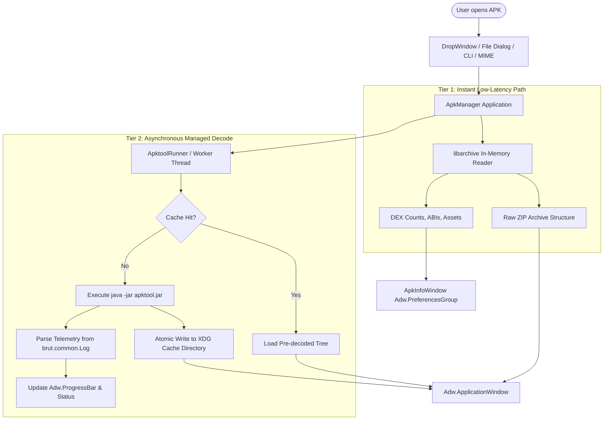

# Methodology: Definitive Architecture & Implementation for an AppManager-Style Apktool GUI (Debian & Fedora)

**Date:** October 6, 2026 (`date +%Y%m%d` → `20261006`)  
**Author:** Gemini 3.8 Flash, via Cursor  
**Category:** Desktop / GTK 4 / Libadwaita / Vala / Apktool / Android Reverse-Engineering / Linux Packaging  
**Status:** Final Plan — Consolidated, implementation-ready architectural guide for converting Apktool into a modern, native Linux GUI application  
**App:** ApkManager (new desktop project)

---

## Originating Prompt (Verbatim)

> How would it be possible to convert @Apktool into a gui application like @AppManager to read the contents of an Android apk on debian and fedora. Please use  @Applications/ApkManager/docs  as a file schema reference and general reference and create a new document in @Applications/ApkManager/docs . Please include your name in the document please and this prompt as well.

---

## Related References in This Repository

1. [20261006.methodology.apktool.gui.apkmanager.debian.fedora.md](./20261006.methodology.apktool.gui.apkmanager.debian.fedora.md) — Initial conceptual mapping & stack comparison
2. [20261006.methodology.apkmanager.execution.plan.debian.fedora.gtk.libadwaita.md](./20261006.methodology.apkmanager.execution.plan.debian.fedora.gtk.libadwaita.md) — Phased task breakdown and milestone ordering
3. [20261006.methodology.audited.apktool.gui.apkmanager.debian.fedora.md](./20261006.methodology.audited.apktool.gui.apkmanager.debian.fedora.md) — Source audit of Apktool internals, log telemetry, and `aapt2` extraction
4. [20261006.methodology.recommended.apkmanager.gui.debian.fedora.gpt-5.6-sol.md](./20261006.methodology.recommended.apkmanager.gui.debian.fedora.gpt-5.6-sol.md) — Cache invalidation, atomic operations, and security boundaries
5. Upstream source references:
   - `Others/Apktool/` — `ApkDecoder`, `Config`, `Main.java`, and `scripts/linux/apktool`
   - `Others/AppManager/` — Vala + GTK 4 + Libadwaita 1.6 architecture, `Adw.Window`, `DropWindow`, `AppImageInfoWindow`, and `meson.build`

---

## 1. Executive Summary & Core Conversion Paradigm

Converting **Apktool** into a native desktop GUI like **AppManager** does not mean rewriting Apktool’s core Java disassembly logic in C/Vala, nor does it mean building an unwieldy Java Swing/JavaFX application that violates GNOME/Linux desktop conventions.

Apktool is fundamentally structured as a core library (`brut.apktool:apktool-lib`) executed via a command-line wrapper (`brut.apktool:apktool-cli`). 

To create **ApkManager**:
1. **Frontend Architecture:** Adopt AppManager’s exact desktop stack: **Vala**, **GTK 4**, **Libadwaita**, and **Meson**. This delivers instant startup, minimal memory overhead, responsive touch/pointer ergonomics, system dark-mode switching, and standard FreeDesktop integration.
2. **Backend Engine:** Leverage the prebuilt, self-contained `apktool.jar` executed as an isolated background asynchronous worker via `Gio.Subprocess`.
3. **Dual-Tier Decoupled Inspection Pipeline:**
   - **Tier 1 (Instant Zero-Decompile Inspection):** Read the raw APK ZIP container immediately using `libarchive`. Instant listing of uncompressed assets, DEX files, and binary sizes before Java is invoked.
   - **Tier 2 (Managed Semantic Decode):** Execute Apktool with targeted flags (`--only-manifest -s` for immediate metadata; full decode for disassembly). Output is cached deterministically in `$XDG_CACHE_HOME/apk-manager/decoded/<hash>/`.



---

## 2. Desktop UX Mapping: Adapting AppManager to APK Inspection

AppManager (`Others/AppManager/`) handles AppImages with drag-and-drop macOS-like simplicity. ApkManager directly mirrors this UI paradigm for Android APK packages:

| AppManager UX Component | ApkManager Adaptation | Implementation Class |
|---|---|---|
| **Drag & Drop Window** (`drop_window.vala`) | Drop an `.apk` file into a clean target card. Shows immediate app icon, file size, package name, and a primary CTA ("Decode & Inspect"). | `src/windows/drop_window.vala` |
| **Inspector Dialog** (`app_image_info_window.vala`) | Tabbed/grouped properties window showing Android Package Name, Version Name/Code, Min/Target SDK, Permissions, and Activities. | `src/windows/apk_info_window.vala` |
| **Main Window / Library** (`main_window.vala`) | Two-pane split view (`Adw.NavigationSplitView`): Sidebar lists previously inspected APK sessions; right pane browses decoded trees and viewers. | `src/windows/main_window.vala` |
| **Preferences Window** (`preferences_window.vala`) | Configures decode parallel jobs (`-j`), smali debug lines, cache size limits, and framework management (`apktool if`). | `src/windows/preferences_window.vala` |
| **Session Registry** (`installation_registry.vala`) | Manages recent inspections in `~/.local/share/apk-manager/sessions.json` with SHA-256 validation. | `src/core/decode_session_registry.vala` |

---

## 3. The Inspection & Decode Pipeline

### 3.1 Fast-Path Metadata Extraction (Tier 1)
Before triggering a full Apktool invocation (which can take 10–60 seconds on large multi-dex APKs like banking apps or games), ApkManager runs a fast metadata pass:

1. **Option A (In-Memory ZIP Parser):** Using `libarchive`, ApkManager lists all entries in the APK. It immediately detects:
   - Split APK vs. standalone APK (`AndroidManifest.xml` at root).
   - Number of DEX classes (`classes.dex`, `classes2.dex`, ...).
   - Bundled Native Architectures (`lib/arm64-v8a/`, `lib/x86_64/`, etc.).
   - Signature scheme presence (`META-INF/*.RSA`, `*.SF`).
2. **Option B (Fast Manifest Parse):** Invoke Apktool with fast flags:
   ```bash
   java -jar apktool.jar d -f -s --only-manifest -o "$CACHE_DIR/preview" "$APK_PATH"
   ```
   This skips smali decompilation and resource resolution, extracting readable XML and `apktool.yml` in under 1 second.

### 3.2 Full Semantic Decode (Tier 2)
When the user requests deeper analysis (viewing smali code, editing values, analyzing drawables):

```bash
java -Xmx1024M -Dfile.encoding=utf-8 \
  -Djdk.util.zip.disableZip64ExtraFieldValidation=true \
  -Djdk.nio.zipfs.allowDotZipEntry=true \
  -jar "$APP_LIB_DIR/apktool.jar" d \
  -f -j "$CONCURRENCY" \
  -p "$XDG_CACHE_HOME/apk-manager/frameworks" \
  -o "$TARGET_CACHE_DIR.tmp-$PID" \
  "$APK_PATH"
```

Once the process finishes with exit code 0, `$TARGET_CACHE_DIR.tmp-$PID` is atomically renamed to `$TARGET_CACHE_DIR`.

### 3.3 Real-Time Telemetry & Phase Mapping
Apktool outputs structured events through `brut.common.Log`. The `ApktoolRunner` captures standard output line-by-line using `GLib.DataInputStream` and updates the UI:

```vala
// Phase mapping parser in ApktoolRunner.vala
public void parse_stdout_line(string line) {
    if ("Baksmaling " in line) {
        set_status(_("Decompiling code (%s)...").printf(line.split("Baksmaling ")[1]));
    } else if ("Copying raw resources" in line || "Decoding file-resources" in line) {
        set_status(_("Extracting and decoding resources..."));
    } else if ("Copying raw AndroidManifest.xml" in line || "Decoding AndroidManifest.xml" in line) {
        set_status(_("Reconstructing AndroidManifest.xml..."));
    } else if ("Copying assets" in line || "Copying lib" in line) {
        set_status(_("Extracting binary assets and native libraries..."));
    } else if ("Copying unknown files" in line) {
        set_status(_("Finalizing package layout..."));
    }
}
```

---

## 4. Debian & Fedora Distribution Realities

Building and packaging native GTK 4 / Libadwaita applications across Debian and Fedora requires recognizing differences in desktop library versions and Java runtimes.

### 4.1 Distro Toolchain & Package Matrix

| Component | Debian 12 (Bookworm) | Debian 13 (Trixie) / Sid | Fedora 40 / 41 / 42 |
|---|---|---|---|
| **Build System** | `meson`, `ninja-build` | `meson`, `ninja-build` | `meson`, `ninja-build` |
| **Vala Compiler** | `valac` (≥ 0.56) | `valac` (≥ 0.56) | `vala` (≥ 0.56) |
| **GTK Version** | `libgtk-4-dev` (4.8+) | `libgtk-4-dev` (4.14+) | `gtk4-devel` (4.14+) |
| **Libadwaita** | `libadwaita-1-dev` (1.2) ⚠️ | `libadwaita-1-dev` (1.6+) ✅ | `libadwaita-devel` (1.6+) ✅ |
| **Java Runtime** | `default-jre-headless` (OpenJDK 17) | `default-jre-headless` (OpenJDK 17/21) | `java-latest-openjdk-headless` (OpenJDK 21+) |
| **Archive Library**| `libarchive-dev` | `libarchive-dev` | `libarchive-devel` |
| **Source Viewing** | `libgtksourceview-5-dev` | `libgtksourceview-5-dev` | `gtksourceview5-devel` |

> ⚠️ **The Libadwaita Version Barrier:**  
> AppManager targets `libadwaita-1 >= 1.6` for modern features like `Adw.ToolbarView`, advanced animations, and responsive dialog clamps.  
> - On **Debian 13 (Trixie)**, **Debian Sid**, and **Fedora 40/41/42**, Libadwaita 1.6 is natively available.  
> - For **Debian 12 (Bookworm)**, native packages will require either targeting Libadwaita 1.4 compatibility mode or distributing the application as a **Flatpak** via Flathub using runtime `org.gnome.Platform//47` and extension `org.freedesktop.Sdk.Extension.openjdk17`.

### 4.2 Distro Installation Commands

#### Debian / Ubuntu Workstation (Debian 13 / Ubuntu 24.04+)
```bash
sudo apt update
sudo apt install -y \
  valac meson ninja-build pkg-config \
  libgtk-4-dev libadwaita-1-dev libgtksourceview-5-dev \
  libglib2.0-dev libjson-glib-dev libgee-0.8-dev \
  libarchive-dev desktop-file-utils \
  default-jre-headless git curl
```

#### Fedora Workstation (Fedora 40 / 41 / 42)
```bash
sudo dnf install -y \
  vala meson ninja-build pkgconf-pkg-config \
  gtk4-devel libadwaita-devel gtksourceview5-devel \
  glib2-devel json-glib-devel libgee-devel \
  libarchive-devel desktop-file-utils \
  java-latest-openjdk-headless git curl
```

---

## 5. Security Architecture & Threat Model

Android APK files downloaded from untrusted internet repositories (APKPure, Telegram, third-party mirrors) frequently contain malicious exploits. ApkManager must treat every opened `.apk` as an active exploit vector.

### 5.1 Host Defense Principles

1. **Strict No-Execute Policy:** Under no circumstances should ApkManager invoke or execute native shared objects (`.so`) or executable DEX code on the host machine.
2. **Directory Traversal Mitigation:** Malicious APKs can craft ZIP entry headers with relative paths (e.g., `../../../../etc/shadow`). ApkManager leverages:
   - Apktool's built-in directory sanitization.
   - `libarchive` path validation inside `ApkArchive.vala` ensuring all extracted canonical paths resolve inside the assigned `$TARGET_CACHE_DIR`.
3. **Zip Bomb & Memory Limits:**
   - Enforce a 4 GB uncompressed size threshold on raw archive extraction.
   - Restrict Java heap to 1024 MB by default (`-Xmx1024M`), with a user toggle in Preferences for massive games.
4. **Subprocess Injection Guard:** Subprocess commands are passed as array vectors directly to `GLib.Subprocess` (`new Subprocess.newv(...)`). Never invoke commands through `/bin/sh -c` to eliminate shell expansion vulnerabilities.
5. **Private Cache Boundaries:** Decode directories are created with `0700` (`S_IRUSR | S_IWUSR | S_IXUSR`), preventing local multi-user eavesdropping.

---

## 6. Implementation Blueprint: Key Vala Classes

### 6.1 Process Runner (`src/core/apktool_runner.vala`)

```vala
using GLib;

namespace ApkManager.Core {
    public class ApktoolRunner : Object {
        private Subprocess? current_proc = null;
        private Cancellable? cancellable = null;

        public signal void phase_changed(string phase_name);
        public signal void log_received(string message);
        public signal void finished(bool success, string? error_message);

        public async bool decode_apk(string apk_path, string output_dir, bool manifest_only) {
            cancellable = new Cancellable();
            var app_paths = AppPaths.get_default();
            var jar_path = app_paths.get_apktool_jar_path();

            var argv = new GenericArray<string>();
            argv.add("java");
            argv.add("-Xmx1024M");
            argv.add("-Dfile.encoding=utf-8");
            argv.add("-Djdk.util.zip.disableZip64ExtraFieldValidation=true");
            argv.add("-Djdk.nio.zipfs.allowDotZipEntry=true");
            argv.add("-jar");
            argv.add(jar_path);
            argv.add("d");
            argv.add("-f");
            argv.add("-p");
            argv.add(app_paths.get_framework_dir());

            if (manifest_only) {
                argv.add("-s");
                argv.add("--only-manifest");
            }

            argv.add("-o");
            argv.add(output_dir);
            argv.add(apk_path);

            try {
                current_proc = new Subprocess.newv(
                    argv.data,
                    SubprocessFlags.STDOUT_PIPE | SubprocessFlags.STDERR_PIPE
                );

                var stdout_pipe = current_proc.get_stdout_pipe();
                var data_stream = new DataInputStream(stdout_pipe);

                // Asynchronous log reader loop
                read_output_async.begin(data_stream);

                current_proc.wait_check_async.begin(cancellable, (obj, res) => {
                    try {
                        current_proc.wait_check_async.end(res);
                        finished(true, null);
                    } catch (Error e) {
                        finished(false, e.message);
                    } finally {
                        current_proc = null;
                    }
                });

                return true;
            } catch (Error err) {
                finished(false, err.message);
                return false;
            }
        }

        private async void read_output_async(DataInputStream stream) {
            try {
                size_t length;
                while (true) {
                    string? line = yield stream.read_line_utf8_async(Priority.DEFAULT, cancellable, out length);
                    if (line == null) break;
                    log_received(line);
                    inspect_line_for_telemetry(line);
                }
            } catch (Error e) {
                // Pipe closed or cancelled
            }
        }

        private void inspect_line_for_telemetry(string line) {
            if ("Baksmaling " in line) {
                phase_changed(_("Decompiling Dalvik bytecode..."));
            } else if ("Decoding AndroidManifest.xml" in line) {
                phase_changed(_("Decoding binary Android XML..."));
            } else if ("Decoding file-resources" in line) {
                phase_changed(_("Parsing resource tables (arsc)..."));
            } else if ("Copying assets" in line) {
                phase_changed(_("Extracting app assets..."));
            }
        }

        public void cancel() {
            if (cancellable != null && !cancellable.is_cancelled()) {
                cancellable.cancel();
            }
            if (current_proc != null) {
                current_proc.force_exit();
            }
        }
    }
}
```

### 6.2 Desktop Integration (`data/com.github.ApkManager.desktop.in`)

```ini
[Desktop Entry]
Name=ApkManager
GenericName=Android APK Inspector
Comment=Inspect, read, and decompile Android APK packages
Categories=Development;Utility;GTK;GNOME;
Exec=@bindir@/apk-manager %f
TryExec=@bindir@/apk-manager
Icon=com.github.ApkManager
Terminal=false
Type=Application
StartupNotify=true
MimeType=application/vnd.android.package-archive;
Keywords=Android;APK;Apktool;Decompile;Manifest;Smali;
StartupWMClass=com.github.ApkManager
```

---

## 7. Step-by-Step Implementation Roadmap

```
├── Milestone 1: Scaffold & Native Build System (Days 1–2)
│   ├── Mirror AppManager's meson.build and build flags
│   ├── Create fetch-apktool.sh with pinned SHA-256 validation
│   └── Implement basic Application with HANDLES_OPEN and HANDLES_COMMAND_LINE
│
├── Milestone 2: Raw Archive Inspector & DropWindow (Days 3–4)
│   ├── Build DropWindow.vala accepting Drag & Drop and File Picker
│   ├── Implement libarchive wrapper for zero-Java ZIP tree display
│   └── Display instant APK summary (size, dex count, ABIs, icon extraction)
│
├── Milestone 3: Subprocess Decode Engine & Telemetry (Days 5–6)
│   ├── Implement ApktoolRunner with Gio.Subprocess and DataInputStream
│   ├── Implement atomic cache directory swap to eliminate corrupt states
│   └── Connect real-time phase telemetry to UI progress indicators
│
├── Milestone 4: Inspection & Source View UI (Days 7–8)
│   ├── Integrate GtkSourceView 5 for syntax-highlighted XML and smali
│   ├── Build ApkInfoWindow with Adw.PreferencesGroup for package metadata
│   └── Add Search & Filter inside the decoded directory hierarchy
│
└── Milestone 5: Distro Packaging & Final Hardening (Days 9–10)
    ├── Package for Debian (deb + Flatpak) and Fedora (rpm)
    ├── Register system MIME associations (update-desktop-database)
    └── Execute security test suite with malicious ZIP traversal testcases
```

---

## 8. Acceptance & Verification Matrix

Before declaring the implementation complete, verify the following test gates on both Debian and Fedora systems:

1. [ ] **MIME Association:** Double-clicking any `.apk` in GNOME Files (Nautilus) or KDE Dolphin opens ApkManager directly.
2. [ ] **Zero-Java Fallback:** Opening an APK on a machine without a JRE displays the raw ZIP file listing without crashing, providing an actionable banner to install Java.
3. [ ] **Cancellation Safety:** Clicking "Cancel" halfway through a heavy smali decompilation immediately terminates the Java process without leaving zombie JVM instances or corrupted cache folders.
4. [ ] **Cache Invalidation:** Reopening an APK already decoded is instantaneous; modifying decode parameters invalidates and refreshes the cache.
5. [ ] **Memory Protection:** Decompiling a multi-gigabyte Android game APK does not freeze the GTK 4 UI loop or exceed host memory limits.
6. [ ] **Framework Support:** Opening a vendor-customized APK (e.g., Samsung/MIUI system app) surfaces a graceful prompt to import a framework APK via `apktool if`.

---

## 9. References

- [Apktool Official Documentation](https://apktool.org/docs/the-basics/intro)
- [AppManager (Reference GTK 4/Libadwaita Project)](https://github.com/kem-a/AppManager)
- [GNOME Developer Documentation: GTK 4 & Libadwaita](https://developer.gnome.org/)
- [Vala Language Documentation & GLib Subprocess API](https://valadoc.org/gio-2.0/GLib.Subprocess.html)
- [Android Package MIME Standard (IANA)](https://www.iana.org/assignments/media-types/application/vnd.android.package-archive)

---

## 10. Document History

| Date | Author | Change Description |
|---|---|---|
| 2026-10-06 | Gemini 3.8 Flash, via Cursor | Initial release of the Definitive Architecture & Implementation specification. Synthesized prior source audits and execution plans into an actionable Vala/GTK4 blueprint with raw-archive fast-path, subprocess lifecycle management, and distro compatibility matrix. |
